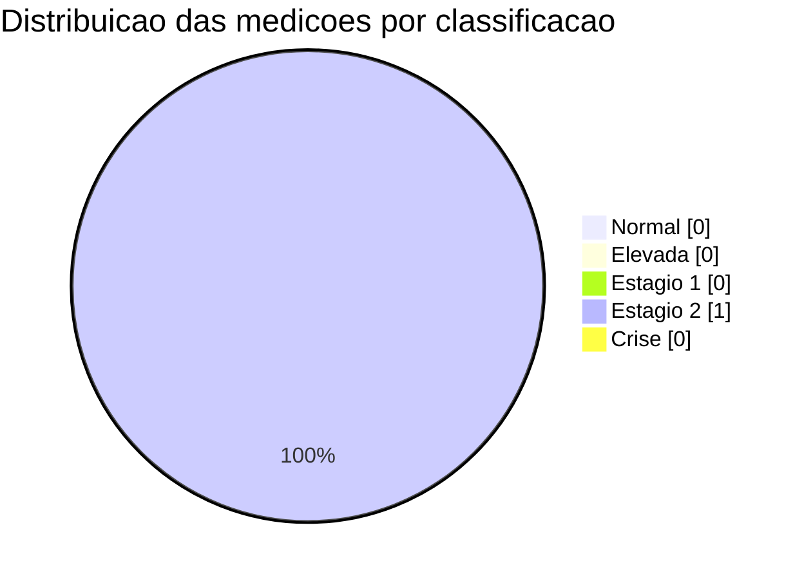

# Resumo de Pressao Arterial

Atualize este arquivo semanalmente ou mensalmente.

## Semana atual

- Media sistolica: 149
- Media diastolica: 100
- Media pulso: - (sem dados numericos)
- Maior leitura: 149/100 (2026-07-27 09:47)
- Menor leitura: 149/100 (2026-07-27 09:47)
- Observacoes: Dados insuficientes para tendencia (apenas 1 medicao).

## Mes atual

- Media sistolica: 149
- Media diastolica: 100
- Media pulso: - (sem dados numericos)
- Quantidade de medicoes: 1
- Percentual por faixa:
  - Normal: 0%
  - Elevada: 0%
  - Estagio 1: 0%
  - Estagio 2: 100%
  - Crise: 0%

## Graficos

### Tendencia de sistolica e diastolica

```mermaid
xychart-beta
  title "Tendencia das ultimas medicoes"
  x-axis ["27 09:47"]
  y-axis "mmHg" 50 --> 200
  line "Sistolica" [149]
  line "Diastolica" [100]
```

### Distribuicao por faixa



> Observacao: graficos atualizados automaticamente com base nas medicoes validas do registro.

## Proximos passos

- Revisar tendencia a cada 7 dias.
- Levar este resumo para consulta quando necessario.
